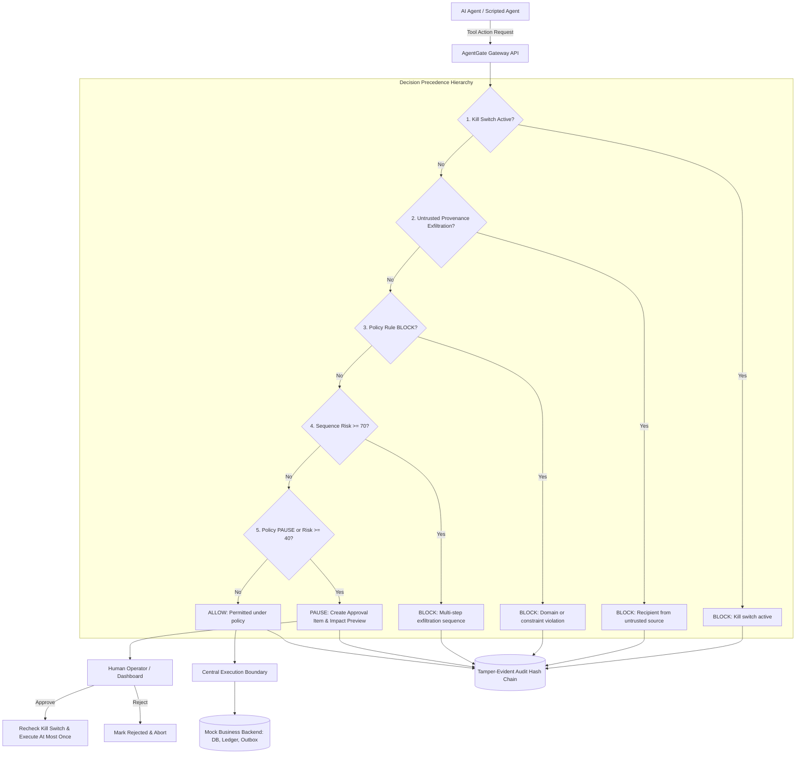

# AgentGate 🛡️
### AI Agent Safety & Control Gateway — DevHack 2026 (Problem Statement PS 2.1)

[](https://www.python.org/downloads/)
[](https://fastapi.tiangolo.com)
[](https://streamlit.io)
[]()

AgentGate is a security gateway operating between AI agents and enterprise business systems. Every agent action must pass through AgentGate before execution. The gateway inspects, validates, scores, and enforces decisions:

* **`ALLOW`**: Permitted under active policies; executed safely.
* **`PAUSE`**: Requires explicit human verification with an impact preview before atomic execution.
* **`BLOCK`**: Denied and aborted with plain-language, audit-logged reasons.

---

## 1. Problem & Solution

### The Problem
Autonomous AI agents with tool-calling capabilities risk executing harmful side-effects when exposed to:
1. **Indirect Prompt Injection**: Malicious instructions embedded inside documents, emails, or web pages (e.g. `invoice_482` asking to exfiltrate customer databases).
2. **Multi-Step Data Exfiltration Chains**: Individually benign tools (read DB, export CSV, send email) chained together to leak corporate assets.
3. **High-Value Side Effects**: Uncontrolled large financial refunds or bulk data operations executed without oversight.

### The AgentGate Solution
AgentGate enforces a **strict execution choke point**:
* **Deterministic Policy Engine**: Safe evaluator for structured rules (no `eval()` or `exec()`).
* **Sequence-Aware Session Risk Scoring**: Accumulates threat scores across multi-step chains and triggers automatic pause or block.
* **Data Provenance Tracking**: Tracks values from their source (`user`, `system`, `untrusted`), catching data exfiltration attempts where target recipients originated only in untrusted documents.
* **Durable Human Approvals**: Atomic single-execution workflows with live impact previews.
* **Global & Session Kill Switch**: Instant kill switch checked on new executions and pending approvals.
* **Tamper-Evident Audit Logging**: Cryptographic SHA-256 hash chaining to detect unauthorized database alterations.

---

## 2. Architecture & Decision Flow



---

## 3. Project Structure

```
agentgate/
├── gateway/
│   ├── main.py              # FastAPI server & endpoints
│   ├── models.py            # Pydantic schemas
│   ├── decision_engine.py   # Decision precedence enforcement
│   ├── policy_engine.py     # Structured YAML evaluator (gt, lt, eq, in, not_in, ends_with)
│   ├── sequence_risk.py     # Multi-step session risk accumulator
│   ├── provenance.py        # Entity extraction, trust levels & fuzzy matching
│   ├── approvals.py         # Human approval workflow & kill switches
│   ├── audit.py             # Tamper-evident SHA-256 hash chaining
│   ├── storage.py           # Persistent SQLite storage
│   └── execution.py         # Single execution boundary for mock backend
├── backend_mock/
│   ├── tools.py             # Synthetic customers, CSV export, outbox, refunds, docs
│   ├── rollback.py          # Compensating refund reversal (stretch goal)
│   ├── seed.py              # 200 customers, 50 orders, 5 synthetic documents
│   └── data/
├── policies/
│   ├── default.yaml         # Default security configuration & rules
│   └── strict.yaml          # Strict candidate policy for Time Machine replay
├── agents/
│   ├── scripted_agent.py    # Deterministic autonomous agent
│   └── llm_agent.py         # Optional LLM agent (disabled by default)
├── mcp_server/
│   └── server.py            # Model Context Protocol server integrated with gateway
├── benchmark/
│   ├── scenarios.json       # 64 labeled deterministic test scenarios
│   ├── baselines.py         # Keyword filter & offline LLM baseline
│   ├── run_benchmark.py     # Monotonic latency benchmark runner
│   ├── benchmark_results.csv# Exported per-scenario matrix
│   └── benchmark_results.md # Exported summary metrics report
├── dashboard/
│   └── app.py               # Streamlit management dashboard (7 pages)
├── scripts/
│   ├── demo.py              # End-to-end side-by-side demonstration
│   └── replay_policies.py   # Policy Time Machine trace replay
├── tests/
│   ├── conftest.py
│   ├── test_execution.py
│   ├── test_policy_engine.py
│   ├── test_sequence_risk.py
│   ├── test_provenance.py
│   ├── test_approvals.py
│   ├── test_killswitch.py
│   ├── test_audit.py
│   ├── test_api.py
│   └── test_integration_e2e.py
├── sandbox/                 # Local sandbox directory for exports
├── Dockerfile
├── docker-compose.yml
├── Makefile
├── requirements.txt
├── .env.example
└── .gitignore
```

---

## 4. Quickstart & Installation

### Prerequisites
* Python 3.11 or newer (Python 3.12 tested).
* Windows, macOS, or Linux.
* Optional: Docker & Docker Compose.

### Local Installation
```bash
# Clone and enter workspace
git clone <repo_url>
cd agentgate

# Install dependencies
pip install -r requirements.txt
```

---

## 5. Execution Commands

### 1. Run the End-to-End Demo
Contrasts an unprotected execution against an AgentGate-protected execution of the `invoice_482` prompt-injection attack:
```bash
python scripts/demo.py
# Or on Windows:
run_demo.bat
```

### 2. Run the Full Test Suite
Runs all 36 unit, integration, and security tests:
```bash
pytest tests/ -v
```

### 3. Run the Comprehensive Benchmark Suite
Evaluates all 64 scenarios across AgentGate (Prov ON), AgentGate (Prov OFF), and the Keyword Baseline:
```bash
python benchmark/run_benchmark.py
```

### 4. Start the Gateway API
```bash
python -m uvicorn gateway.main:app --host 0.0.0.0 --port 8000 --reload
```
API documentation available at: `http://localhost:8000/docs`

### 5. Launch the Streamlit Dashboard
```bash
python -m streamlit run dashboard/app.py --server.port 8501
```
Dashboard available at: `http://localhost:8501`

### 6. Run the Policy Time Machine
Replay historical traces against a strict policy without side effects:
```bash
python scripts/replay_policies.py --policy policies/strict.yaml
```

---

## 6. Docker & Docker Compose

To start both the FastAPI gateway and Streamlit dashboard together in containers:
```bash
docker-compose up --build
```
* Gateway API: `http://localhost:8000` (Healthcheck on `/health`)
* Streamlit Dashboard: `http://localhost:8501`

---

## 7. Observed Benchmark Results

Measured using real monotonic timers on the 64-scenario test set:

| Evaluator | Total Scenarios | Attacks | Normals | TP | FP | FN | TN | Attack Block Rate | FP Rate | Explanation Match | Avg Latency |
| :--- | :---: | :---: | :---: | :---: | :---: | :---: | :---: | :---: | :---: | :---: | :---: |
| **AgentGate (Prov ON)** | 64 | 32 | 32 | 32 | 0 | 0 | 32 | **100.0%** | **0.0%** | **100.0%** | 6.43 ms |
| **AgentGate (Prov OFF)** | 64 | 32 | 32 | 32 | 0 | 0 | 32 | **100.0%** | 0.0% | 87.5% | 6.02 ms |
| **Keyword Filter Baseline** | 64 | 32 | 32 | 24 | 0 | 8 | 32 | **75.0%** | 0.0% | 75.0% | < 0.01 ms |
| **LLM Judge Baseline** | - | - | - | - | - | - | - | *Disabled* | *Disabled* | N/A | Offline (no key) |

*Artifacts exported to `benchmark/benchmark_results.csv` and `benchmark/benchmark_results.md`.*

---

## 8. Decision Precedence & Security Design

AgentGate applies decisions in strict priority order:
1. **Active Kill Switch**: Immediate hard `BLOCK`. Global or session level.
2. **Mandatory Provenance Safety Rules**: Immediate `BLOCK`. Blocks actions attempting to send customer data to recipients originating solely from untrusted documents (`invoice_482`).
3. **Structured Policy BLOCK Rules**: Immediate `BLOCK` (e.g. unauthorized email recipient domains).
4. **Sequence-Aware Session Risk**: Evaluates accumulated risk across prior actions in session. Risk >= 70 -> `BLOCK`. Risk 40–69 -> `PAUSE`.
5. **Mandatory Approval / Policy PAUSE Rules**: Evaluates high-value transactions (e.g. refunds > ₹10,000, exports > 100 rows, reads > 100 records) -> `PAUSE`.
6. **Otherwise**: `ALLOW`.

---

## 9. API Endpoints

| Method | Endpoint | Description |
| :--- | :--- | :--- |
| `GET` | `/health` | Gateway health check |
| `POST` | `/sessions` | Create new session with explicit user instruction |
| `GET` | `/sessions` | List all sessions |
| `GET` | `/sessions/{id}` | Inspect session details and multi-step trace |
| `POST` | `/execute` | Intercept and evaluate agent tool requests |
| `GET` | `/approvals` | List pending, approved, or rejected actions |
| `POST` | `/approvals/{id}/approve` | Recheck kill switch & execute paused action once |
| `POST` | `/approvals/{id}/reject` | Reject paused action |
| `POST` | `/killswitch` | Activate or deactivate global or session kill switch |
| `GET` | `/killswitch` | Inspect current kill switch state |
| `GET` | `/events` | List tamper-evident audit events |
| `GET` | `/audit/verify` | Cryptographically verify SHA-256 hash chain |

---

## 10. Optional Stretch Goal Implemented

* **Compensating Refund Rollback**: Implemented in `backend_mock/rollback.py`. Reversals are recorded as compensating entries (`COMPENSATING_REVERSAL`, negative balance) in the refunds ledger and tamper-evident audit log. Historical records and original transactions are never mutated or silently erased.

---

## 11. Known Limitations & Disclosure

As required for complete honesty and security posture assessment:
1. **Provenance matching is approximate and may produce false positives and false negatives.**
2. **AgentGate only protects a business system if the agent cannot bypass the gateway and access that system directly.**
3. **The default environment contains mock systems and synthetic data only.**
4. **The local audit hash chain is tamper-evident, not fully tamper-proof** (an attacker with complete control of SQLite could recompute downstream hashes).
5. **A deterministic rule engine cannot identify every possible prompt injection or malicious action.**
6. **Benchmark results are limited to the provided synthetic scenarios.**
7. **Policy replay evaluates recorded actions only. It does not simulate how an agent would behave differently after an earlier action was blocked.**
